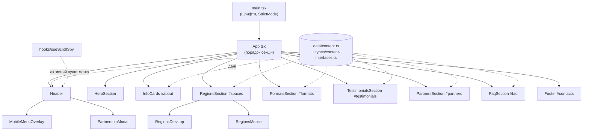

# Твій — Простори підтримки дітей (ОБСЄ)

Односторінковий (single-page) лендінг мережі просторів психологічної та соціальної підтримки дітей «Твій», що працює за підтримки Програми підтримки ОБСЄ для України та Національної соціальної сервісної служби України. Сайт українською мовою, повністю адаптивний (мобільний / планшет / десктоп).

Сайт показує: що це за проєкт, де розташовані 21 простір у 6 областях (інтерактивна мапа з адресами), які є формати роботи, відгуки, як стати партнером, та поширені запитання.

---

## Стек

| Шар | Технологія | Версія |
|---|---|---|
| UI | React | 19 |
| Мова | TypeScript | 6 |
| Збірка / dev-сервер | Vite (+ `@vitejs/plugin-react`) | 8 |
| Стилі | Tailwind CSS 4 (через `@tailwindcss/vite`) | 4.x |
| Іконки | MynaUI (`@mynaui/icons-react`) | 0.4 |
| Шрифти | Ubuntu, Source Sans 3 Variable (`@fontsource*`, self-hosted) | — |
| Лінтинг | ESLint 10 + typescript-eslint + react-hooks + react-refresh | — |

Бекенду немає: це статичний фронтенд. Форма партнерства (модальне вікно) надсилає дані через сервіс Web3Forms напряму з браузера.

---

## Швидкий старт

```bash
npm install
npm run dev       # dev-сервер з HMR (http://localhost:5173)
npm run build     # tsc -b (перевірка типів) + vite build -> dist/
npm run preview   # локальний перегляд зібраного dist/
npm run lint      # ESLint
```

Потрібен Node.js 20+ (Vite 8 цього вимагає).

---

## Архітектура

Це **компонентна архітектура «одна секція — один компонент»**, де весь текстовий контент винесено в окремий шар даних. Стану майже немає, тому окремого state-менеджера немає.



### Ключові архітектурні рішення

1. **Дані окремо від розмітки.** Увесь український текст (навігація, картки, області й адреси, формати, відгуки, FAQ) лежить у `src/components/data/content.ts` і описаний інтерфейсами в `src/types/content-interfaces.ts`. Щоб змінити текст чи додати адресу простору, редагуємо лише цей файл, компоненти не чіпаємо.
2. **Навігація якорями.** `App.tsx` передає кожній секції `id` (`about`, `spaces`, `formats`…), а `href` у `navLinks` — це `#id`. Плавний скрол забезпечує `scroll-behavior: smooth` у CSS, без JS-бібліотек. Кожен `href` у `navLinks` обов'язково має мати елемент з таким самим `id` (у футера це `id="contacts"`).
3. **Scroll-spy.** Хук `useScrollSpy(ids, offset)` на базі `IntersectionObserver` визначає, яка секція зараз у верхній третині екрана, і підсвічує відповідний пункт меню. `offset` (80px) компенсує липкий (`sticky`) хедер.
4. **Локальний стан замість глобального.** Стан простий і не спільний між гілками, тому використано `useState`: відкрите меню, відкрите питання FAQ (single-open акордеон), вибраний регіон на мапі, відкрите модальне вікно. Zustand/Redux не потрібні.
5. **Дві версії мапи, один стан.** `RegionsSection` тримає `selectedId` і віддає його або `RegionsDesktop` (мапа + пілюлі + панель адрес, `md:` і вище), або `RegionsMobile` (акордеон з силуетами областей, нижче `md`). Показ перемикається Tailwind-класами `hidden md:block` / `md:hidden`.
6. **Плавна зміна мапи.** У `RegionsDesktop` дві накладені картинки: стара залишається знизу, нова плавно проявляється зверху (`opacity` transition), після `transitionEnd` вона стає базовою.
7. **Рвані краї секцій.** Компонент `TornEdge` розміщує SVG-розділювачі (`torn-top.svg`, `torn-bottom.svg`) зверху/знизу кольорових смуг.
8. **Layout-примітиви.** `Container` (макс. ширина 1440px) і `Section` (обгортка з `id`) використовуються в усіх секціях для однакових відступів.

### Дизайн-система (Tailwind 4, `@theme` у `App.css`)

- Брейкпоінти: `sm` 480px, `md` 768px, `lg` 1200px.
- Кольори бренду: `brand-blue` (+ `-dark`, `-bright`, `-light`), `brand-green`, `brand-yellow`, `brand-red`, `brand-navy`, `brand-gray`, `white-neutral`, `brand-violet-gray`.
- Шрифти: `font-ubuntu` (заголовки/акценти), `font-heading` (Source Sans 3 Variable).
- Типографіка адаптується через CSS-змінні (`--text-*`), які збільшуються на ширині 900px та 1200px.

---

## Структура проєкту

```
obse-tviy/
├── index.html                  # точка входу, favicon, manifest, <title>
├── vite.config.ts              # плагіни: react + tailwindcss
├── eslint.config.js            # flat config: TS + React Hooks + React Refresh
├── tsconfig*.json              # app / node конфіги (strict, bundler mode)
├── public/
└── src/
    ├── main.tsx                # рендер, підключення шрифтів
    ├── App.tsx                 # склад сторінки та id секцій
    ├── App.css / index.css     # Tailwind, @theme-токени, CSS-змінні
    ├── hooks/
    │   └── useScrollSpy.ts     # підсвітка активного пункту меню
    ├── types/
    │   └── content-interfaces.ts   # NavLink, Region, FormatCard, FaqItem…
    ├── components/
    │   ├── Header.tsx              # липкий хедер, меню, CTA «Стати партнером»
    │   ├── MobileMenuOverlay.tsx   # повноекранне меню (блок скролу, Esc)
    │   ├── PartnershipModal.tsx    # форма партнерства (Web3Forms)
    │   ├── HeroSection.tsx
    │   ├── InfoCards.tsx           # «Для кого? / Яка допомога? …»
    │   ├── RegionsSection.tsx      # стан вибраної області
    │   ├── RegionsDesktop.tsx      # мапа + пілюлі + адреси
    │   ├── RegionsMobile.tsx       # акордеон областей
    │   ├── MapHeading.tsx
    │   ├── FormatsSection.tsx      # 6 форматів роботи
    │   ├── TestimonialsSection.tsx
    │   ├── PartnersSection.tsx     # типи підтримки + логотипи партнерів
    │   ├── FaqSection.tsx          # акордеон Q&A
    │   ├── Footer.tsx              # контакти, дисклеймер ОБСЄ, соцмережі
    │   ├── layout/                 # Container, Section, TornEdge
    │   └── data/content.ts         # ВЕСЬ контент сторінки
    └── assets/                 # logos, maps, regions (svg), icons, images, favicons
```

---

## Технічні особливості

- **Адаптивність:** mobile-first на Tailwind; сітки змінюються 1 → 2 → 3/4 колонки, мапа/адреси мають окремі мобільну та десктопну версії.
- **Доступність:** семантичні `<header>/<nav>/<section>/<footer>`, `aria-label` на іконкових кнопках, `aria-expanded` в акордеоні FAQ, `aria-hidden` на декоративних зображеннях, закриття меню по `Esc`.
- **Блокування скролу** body, поки відкрите мобільне меню.
- **Продуктивність:** `loading="lazy"` для некритичних зображень, шрифти self-hosted (без запитів до Google Fonts), Vite code-splitting і хешування асетів.
- **Типобезпека:** `tsc -b` у `build` (`noUnusedLocals`, `noUnusedParameters`, `verbatimModuleSyntax`, `erasableSyntaxOnly`), тож проєкт не збереться з помилками типів.
- **Форма партнерства:** надсилається з браузера на Web3Forms (без власного сервера). Ключ доступу публічний за дизайном сервісу; листи приходять з `notify@web3forms.com`, тому організації варто один раз натиснути «Не спам» і додати адресу в контакти або створити Gmail-фільтр.

### Відомі підводні камені

| Проблема | Пояснення | Рішення |
|---|---|---|
| Збірка падає на Linux/CI | У git файли мапи та логотип лежать як `*.PNG`, а імпорти в `content.ts` і `PartnersSection.tsx` пишуть `*.png`. На Windows/macOS (регістронезалежні ФС) це працює, на Linux — ні. | Перейменувати файли в нижній регістр (`git mv x.PNG tmp && git mv tmp x.png`) або виправити імпорти. **Обов'язково до налаштування CI.** |
| Якір не працює | `href="#id"` без елемента з таким `id` | Перевіряти збіг `navLinks` ↔ `id` секцій |
| Секція ховається під хедером | Хедер `sticky` | `scroll-mt-20` на цільовому елементі |

---

## CI/CD

target: test | production
checkout + Node 20npm ci
npm run buildVITE_BASE = / або /test/
upload-artifactdist-SHA, 90 днів
FTPS upload dist/-> / або /test/
tviy.org.ua абоtviy.org.ua/test/
Workflow 1: GitHub Pages (автоматично)
push у main
checkout + Node 20npm install
npm run buildVITE_BASE=/osce-tvyi/
configure-pagesupload-pages-artifact (dist)
deploy-pages-> *.github.io/osce-tvyi/

Workflow 1 — GitHub Pages
Спрацьовує на кожен push у main (і вручну з вкладки Actions).
permissions дають токену право писати в Pages (pages: write, id-token: write); код лише читається (contents: read).
concurrency: pages з cancel-in-progress: false: одночасно йде лише один деплой, а вже запущений не скасовується, щоб не залишити сайт у напівопублікованому стані.
Збірка: npm run build (спочатку tsc -b, тобто помилки типів зупиняють деплой, потім vite build) з підстановкою VITE_BASE=/osce-tvyi/, бо на Pages сайт живе у підпапці репозиторію.
dist/ пакується в артефакт і публікується; URL з'являється у змінній page_url середовища github-pages.

Workflow 2 — Hetzner через FTPS
Запускається вручну: Actions → «Deploy to Hetzner (FTP)» → Run workflow → вибір test або production. Автоматично не запускається, поки не затверджено перехід на production.
Те, що вибрано в target, керує двома речами: VITE_BASE (шляхи до асетів у збірці) і server-dir (папка на FTP). Вони мають збігатися: /test/ ↔ /test/, / ↔ /.
Перед завантаженням збірка зберігається як артефакт dist-<commit SHA> на 90 днів. Це дає змогу відкотитися: завантажити старий артефакт і залити його вручну.
FTP-Deploy-Action вантажить dist/ по FTPS (шифроване з'єднання) і синхронізує зміни: заливає нове й видаляє з сервера те, чого більше немає в збірці. Саме тому exclude містить info/** і test/**: при деплої в корінь не чіпаються стара копія лендінгу та тестова папка.
Action залишає на сервері службовий файл стану (.ftp-deploy-sync-state.json), за яким порівнює, що змінилося. Не видаляйте його вручну, інакше наступний деплой завантажить усе заново.
```

### Що потрібно налаштувати для запуску

1. У репозиторії: **Settings → Pages → Source: GitHub Actions**
2. Виправити регістр розширень `.PNG` → `.png` (інакше крок `build` впаде)
3. Якщо в `package.json` змінюються залежності, оновлюйте `package-lock.json`

---

## Ліцензія та авторство

Матеріали проєкту (логотипи, тексти, зображення) належать організаціям-учасницям проєкту «Твій». Дисклеймер ОБСЄ наведено у футері сайту.
